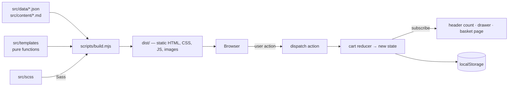

# Hair Medics UK — brand & website

A complete redesign of [hairmedicsuk.shop](https://hairmedicsuk.shop): a new brand identity, and a fast, accessible, data-driven storefront built with **vanilla JavaScript, SCSS and a tiny Node build script** — no framework.

| | |
|---|---|
| **Pages** | 82 (home, shop, 12 categories, 52 products, assessment, basket, checkout, about, contact, reviews, 8 legal pages, brand guidelines, 404) + redirects for old URLs |
| **Brand** | Logo suite, colour tokens, type system, voice & tone — see `/brand/` |
| **Audit of the old site** | [`docs/site-audit.md`](docs/site-audit.md) — 85 URLs × desktop/tablet/mobile, 46 findings |
| **Tests** | 13 unit tests · 8 end-to-end journeys · 246 page-view checks (overflow, errors, images, headings, tap targets) |

---

## Quick start

```bash
npm install
npm run dev        # build + watch + serve at http://localhost:4173
```

| Command | What it does |
|---|---|
| `npm run build` | Production build into `dist/` |
| `npm run dev` | Rebuilds whenever something in `src/` changes, and serves `dist/` |
| `npm run serve` | Serve an existing `dist/` |
| `npm test` | Unit tests (cart logic, validation) — no browser needed |
| `npm run qa` | Browser QA: every page × 3 viewports, plus the user journeys (needs `npm run serve` running, and `npx playwright install chromium` once) |
| `npm run logo` | Regenerate the logo SVGs from `scripts/build-logo.mjs` |
| `node scripts/import-products.mjs` | Re-sync products, prices and images from the live WooCommerce shop |

---

## Project structure

```
src/
  data/                 ← THE SOURCE OF TRUTH (edit these, not the HTML)
    site.json           business details, phone, regulatory info, form endpoints
    products.json       52 products (generated by the importer)
    product-overrides.json  manual fixes that survive a re-import
    categories.json     navigation & category copy
    assessment.json     the 6-step medical questionnaire
    reviews.json        verbatim Google review excerpts
    tokens.json         brand colours → CSS variables + /brand/ page
  content/legal/*.md    legal pages in Markdown
  templates/            pure functions: data in → HTML out
    lib/                html`` (auto-escaping), icons, formatting
    components/         layout (header/footer/drawers), product card, notices…
    pages/              one file per page type
  scss/                 design system: abstracts → base → layout → components → pages
  js/                   browser code (ES modules, no bundler)
    lib/                store (observer pattern), storage, validation, DOM helpers
    cart/               basket state: a pure reducer + selectors
    ui/                 one module per feature (drawer, filters, assessment…)
  assets/               logo SVGs, optimised WebP images
scripts/
  build.mjs             the whole static-site generator (~300 lines, read it!)
  import-products.mjs   WooCommerce Store API → products.json + WebP images
  build-logo.mjs        outlines the wordmark into SVG paths
tests/                  unit tests + Playwright QA
docs/                   audit report + screenshots
```

---

## How it works



### Why it's built this way (the decisions, and the reasons)

1. **Data first, UI second.** Every fact (a price, a phone number, a GMC number, a question in the assessment) lives once in `src/data`. Templates only *display* data. The old site showed **two phone numbers and two pharmacy numbers** because the same fact was typed in several places; a single source of truth makes that impossible.

2. **Static HTML, then JavaScript on top (progressive enhancement).** Every product, category and policy is real HTML generated at build time — fast, indexable by Google, and readable even if JavaScript fails. JavaScript only *adds* things: instant search, the basket, the multi-step form.

3. **Components are pure functions.** `productCard(ctx, product)` returns HTML and touches nothing else, so it's predictable and reusable. The `html` tagged template escapes every value automatically, so product text can never inject markup.

4. **One-way data flow for the basket.** Buttons don't update the page directly; they `dispatch({ type: 'add', … })`. A *pure reducer* computes the new state, and every view that subscribed re-renders. That's the Observer pattern — the same idea behind Redux — in ~25 lines (`src/js/lib/store.js`). Because the reducer is pure, it is unit-tested without a browser (`tests/cart.test.js`).

5. **Native HTML before custom widgets.** The menu and basket are `<dialog>` elements (free focus-trapping, Esc to close); accordions are `<details>`; option pickers are real radio buttons. Less code, better accessibility.

6. **Validation that respects people.** Rules are pure functions (`src/js/lib/validate.js`). Errors appear on submit, then disappear as soon as the field is fixed (the GOV.UK pattern). Date of birth uses three boxes rather than a date picker.

7. **Privacy by default.** Medical answers are kept in `sessionStorage` (cleared when the tab closes), never `localStorage`. Fonts are self-hosted (no requests to Google). There are no tracking scripts, so no cookie banner is needed — the basket uses strictly-necessary storage only.

8. **Old URLs keep working.** Product slugs are unchanged; misspelt or retired URLs (`/product-category/dutesteride/`, `/cookie-policy/`, `/search/`…) get redirect pages, so existing links and search rankings aren't lost.

---

## The brand

| | |
|---|---|
| **Promise** | *Clinically-led hair loss treatment, delivered to your door.* |
| **Mark** | Three hair strands rising from the scalp, each taller than the last — hair, and growth over time. |
| **Type** | Fraunces (headlines) + Manrope (interface). Both open source, self-hosted. |
| **Colour** | Midnight Ink `#0B2230` · Follicle Teal `#14605B` · Copper `#B4643C` · Bone `#FBF8F3` |
| **Voice** | Clinical, not cold · honest about results · reassuring · plain English |

The full guidelines are a page on the site (`/brand/`), generated from the same tokens the CSS uses — so the guidelines can never drift from the real colours, and contrast ratios are calculated automatically at build time.

---

## Common tasks

**Change a price or add a product** — change it in WooCommerce, then run `node scripts/import-products.mjs` and rebuild. To fix a name or flag permanently, add it to `src/data/product-overrides.json`.

**Edit a legal page** — edit the Markdown in `src/content/legal/`.

**Change a colour** — edit `src/data/tokens.json`; the build regenerates `src/scss/abstracts/_tokens.scss` and the brand page.

**Change a question in the medical assessment** — edit `src/data/assessment.json` (`showIf` makes a question conditional; `rules` block progress with a message).

---

## Going live — checklist

This repository is a complete front end. Before it replaces the live shop:

- [ ] **Payments & orders.** `/checkout/` currently hands off to phone/email. Options: (a) port these templates into the WooCommerce theme and keep its checkout; (b) keep this static site and use the WooCommerce Store API (`/wp-json/wc/store/v1/cart`) for a headless basket/checkout; (c) Stripe Checkout + an order webhook. Prices must always be re-checked server-side.
- [ ] **Form handlers.** Set `forms.contactEndpoint` and `forms.assessmentEndpoint` in `src/data/site.json` to secure, UK-GDPR-compliant endpoints. Until then, both forms run in a clearly labelled **preview mode** and send nothing.
- [ ] **Regulatory review** with your superintendent pharmacist / legal adviser — see the *Compliance* section of the audit (POM promotion, medicinal claims, 7-day returns, the home-use disclaimer, the unfinished `/legal-compliance/` page). Legal pages were migrated **verbatim**; they have not been rewritten.
- [ ] **Confirm facts that conflict on the old site:** pharmacy number (9013149 vs 9012121) and phone number (020 3441 3026 vs 0333 577 6554 — returns page).
- [ ] **Image licences** — the lifestyle photos are reused from the current site; confirm their stock licences cover the new site.
- [ ] **Analytics** — if you add any, add a consent banner first (the old site fires Google Analytics before consent).
- [ ] Remove `PREVIEW=1` from the deploy workflow when this becomes the real site.

## Deploying a preview (GitHub Pages)

`.github/workflows/deploy.yml` tests and builds every push and pull request, and deploys `main` to GitHub Pages as a **noindex** preview (so Google never indexes it next to the real shop). One-time setup: **Settings → Pages → Source: GitHub Actions**.

---

## Learning notes

If you're studying this codebase, a good reading order is:

1. `src/data/site.json` and `src/data/products.json` — what the site *knows*
2. `src/templates/lib/html.mjs` — 30 lines that make templates safe
3. `src/templates/components/ui.mjs` → `pages/product.mjs` — components composing into a page
4. `scripts/build.mjs` — the whole pipeline, top to bottom
5. `src/js/lib/store.js` → `src/js/cart/cart.js` → `src/js/ui/cart-view.js` — state, reducer, views
6. `src/data/assessment.json` → `src/js/ui/assessment.js` — a data-driven multi-step form
7. `tests/` — how each piece is proven to work
