# Hair Medics Shop — website audit

**Site:** https://hairmedicsuk.shop (WordPress + WooCommerce)
**Date:** 22 October 2026
**Audience:** site owner / developer. Each finding explains what we found, why it matters and how to fix it.

> **Not legal advice.** The compliance and consumer-law points below are things we observed that deserve a professional review. They are not legal or regulatory advice. Please go through every compliance item with your superintendent pharmacist and/or a legal adviser before you change or rely on it.

---

## Contents

1. [Scope and method](#1-scope-and-method)
2. [Executive summary](#2-executive-summary)
3. [All findings by severity](#3-all-findings-by-severity)
4. [Responsive and visual review (by viewport)](#4-responsive-and-visual-review-by-viewport)
5. [UX and conversion](#5-ux-and-conversion)
6. [Accessibility](#6-accessibility)
7. [SEO and metadata](#7-seo-and-metadata)
8. [Content and data quality](#8-content-and-data-quality)
9. [Compliance and trust](#9-compliance-and-trust)
10. [Technical and hosting](#10-technical-and-hosting)
11. [What is working well](#11-what-is-working-well)
12. [Suggested order of work](#12-suggested-order-of-work)
- [Appendix A — per-URL results](#appendix-a--per-url-results)

---

## 1. Scope and method

**Pages audited: 85 URLs**, which is every URL in the site's XML sitemaps:

| Type | Count |
|---|---|
| Pages (home, shop, basket, policies and so on) | 20 |
| Product categories | 12 |
| Product tag (`best-seller`) | 1 |
| Products | 52 |

**Viewports.** We loaded each URL at three screen sizes, which gives 255 page loads:

| Name | Size | Notes |
|---|---|---|
| Desktop | 1440 × 900 | mouse |
| Tablet | 768 × 1024 | touch, mobile user agent |
| Mobile | 390 × 844 | touch, iPhone user agent (roughly an iPhone 14/15) |

**Automated checks on every load:**

- HTTP status, JavaScript console errors and failed network requests
- `<title>`, every `<h1>`, and the meta description
- Horizontal overflow (is the page wider than the screen?)
- Image count, broken images, images with a missing or empty `alt`
- Tap targets under 32 px (tablet and mobile only)
- Text smaller than 12 px
- Form fields without a label
- Whether the cookie-consent modal appeared, and the page height
- Two screenshots: the **first screen** a new visitor sees (cookie modal included), and the **full page** after clicking "Deny" on the modal

On desktop we also captured the page text, product data, navigation and footer links, and structured data (JSON-LD).

**Data cross-check.** We compared product names, prices, variations and purchasability with the shop's public WooCommerce Store API (`/wp-json/wc/store/v1/products` and the variation endpoints).

**Manual visual review.** We reviewed screenshots of the home page, shop, five categories (Minoxidil, Finasteride, Dutesteride, Laser Diode, Hair Transplant Deposit), about 10 product pages (simple and variable), basket, checkout, account, contact, about, Google reviews, medical assessment, the policy pages and both search pages. We looked at every one of them at all three viewports.

**Limitations. Please read these before acting on the numbers.**

- **Load times are not reported.** The site's firewall rate-limits automated visits, so our requests went through a proxy that retried and backed off. That makes our timings meaningless. To check performance, run Lighthouse or [PageSpeed Insights](https://pagespeed.web.dev/) from a normal browser.
- **Checkout was not tested.** With an empty basket, `/checkout/` simply shows the basket. We placed no orders, submitted no forms and did not log in.
- **Some images look blank in full-page screenshots.** Lazy-loaded images further down a page sometimes appear as white boxes. This comes from how the screenshots were taken, not from the site: no broken images were detected and the same images load in the first-screen shots.
- **Interactive parts were captured in their default state.** That includes menus, dropdowns, carousels and hover effects.
- **The tap-target count is a heuristic.** It counts any link, button or field under 32 px in either direction, including links inside sentences.
- **The "unlabelled field" check is not reported as an issue.** It flagged exactly one field on every page, including pages with no form. That is almost certainly reCAPTCHA's hidden response box.
- **Colour contrast is estimated.** We measured it from JPEG screenshots, so confirm it against the real CSS colours.
- **The overflow check needed a correction.** It first reported no overflow at all. On closer inspection, the browser had widened the page on five mobile product pages to fit content that was too wide. Those five pages are reported under H6.

---

## 2. Executive summary

- **Technically the site is stable.** All 255 page loads returned HTTP 200 and no images were broken. Pages fit the screen at every size except five mobile product pages.
- **The biggest risks are in the content, not the code.**
  - Prescription-only and compounded medicines are promoted to the public, using "Bestseller" badges and "cure" / "clinically proven" claims.
  - The site shows **two different pharmacy registration numbers**.
  - An unfinished legal page with template placeholders is live.
  - A disclaimer page says the products are *not* medicines and must not be used therapeutically.
- **There are consumer-law and privacy gaps.**
  - The returns policy allows **7 days**, but distance sales generally carry a 14-day cancellation right.
  - Marketing consent is **pre-selected** on two forms.
  - Google Analytics sends hits **without any consent signal**.
  - The privacy policy is dated 2024 and was written for a different domain.
- **The product catalogue has errors that customers will notice.**
  - 3 products are priced **£0** and cannot be bought, yet they are featured first on the empty basket.
  - One product name is garbled, so it is unclear which medicine it is, and it also breaks the mobile layout.
  - The hair-transplant deposit options don't match what is charged.
  - The laser cap offers models that don't exist and claims "FDA approved".
- **Usability problems cost sales.**
  - Floating badges cover buttons, including the **Log in** button.
  - There is **no product search on phones or tablets**.
  - Long ALL-CAPS product names wrap to 6–10 lines on mobile.
  - Product dropdowns are cut off to "Choos".
  - On tablet, the Add to basket button sits below the first screen.
- **SEO basics are missing.**
  - **75 of 85 pages have no meta description**, including 51 of 52 products.
  - "Dutesteride" and "minoxdil" are misspelt in menus and URLs.
  - `/shop/` has an empty H1.
  - Empty duplicate pages are listed in the sitemap.
- **Most fixes are content or settings changes in WordPress, not development work.** Deal with the five Critical items first, ideally this week, and the twelve High items within a month.

**Findings by severity: 5 Critical · 12 High · 20 Medium · 9 Low (46 in total).**

---

## 3. All findings by severity

| Severity | What it means |
|---|---|
| **Critical** | Regulatory or legal exposure, or something that could mislead patients about a medicine. Fix immediately. |
| **High** | Likely to break trust, lose sales or breach consumer/privacy rules. Fix within weeks. |
| **Medium** | Noticeable quality, accessibility or SEO problem. Plan into the next sprint. |
| **Low** | Polish, housekeeping or "nice to have". |

| # | Finding | Where | Severity | Recommendation |
|---|---|---|---|---|
| C1 | Prescription-only (POM) and unlicensed compounded medicines are **promoted to the public**: "Bestseller" badges and prices on the home page, Finasteride/Dutasteride as top-level menu items, and POMs (including pack size) can be chosen and added to the basket before any consultation | Home, header menu, categories, POM product pages | Critical | Review with your superintendent pharmacist / legal adviser. Move to a consultation-first journey and remove promotional badges and claims from POMs |
| C2 | **Medicinal claims** for compounded/unlicensed products: "Cure hair loss at home", "clinically proven", "much more effective than minoxidil alone", "You will be amazed…" | Home, minoxidil products, Minocream | Critical | Remove "cure". Keep only claims you can evidence. Review against CAP Code section 12 and MHRA guidance |
| C3 | **Two different pharmacy registration numbers**: footer says "Pharmacy Number 9013149", medical assessment says "reg number 9012121". The manufacturer is also named differently on the two pages | Footer (every page), `/medical-assessment/` | Critical | Check the GPhC register, correct it everywhere and link to the register entry. Show the details GPhC expects |
| C4 | `/legal-compliance/` is an **unfinished draft published live**: placeholder text, an internal "Publication and compliance checklist", 11 H1s. The legal entity, company number and registered office appear **nowhere** on the site | `/legal-compliance/`, footer | Critical | Unpublish it now. Publish the completed policies. Add company name, number and registered office to the footer |
| C5 | `/home-use-products-disclaimer/` says no product is a "food, drug or medical device" and that none may be used "for therapeutic or diagnostic purposes". It contains a sweeping liability exclusion and names "Hair Medical U.K." and www.hairmedicsuk.com | `/home-use-products-disclaimer/` | Critical | Unpublish it. Replace with accurate wording reviewed by your legal adviser |
| H1 | Returns policy gives **"7 days from the date of delivery"**. Distance sales generally carry a 14-day cancellation right, with some exceptions. It also contradicts the "statutory period" wording on `/legal-compliance/` | `/return-policy/` | High | Legal review. State the 14-day right and exactly which exceptions apply |
| H2 | **Marketing consent is pre-selected**: the registration form has "Subscribe to our newsletter" ticked, and the contact form's "Join our mailing list?" defaults to **Yes** (data shared with Mailchimp) | `/my-account/`, `/contact/` | High | Leave unticked / default to "No". Check how existing subscribers were obtained |
| H3 | Google Analytics 4 sends hits on every page load with **no consent state set** (`gcd=13l3l3l3l1l1`), in sessions where the visitor never clicked Accept | All pages | High | Verify in DevTools. Block GA until consent, or switch on Consent Mode v2 in Complianz |
| H4 | Privacy policy is **out of date and for another site**: "Last updated June 03, 2024", refers to `https://hairmedics.co.uk`, and describes sharing data with Skin Medics UK. It must cover the health data collected by the medical form | `/privacy-policy/` | High | Rewrite it for this shop: who the controller is, health data, sharing with prescriber and pharmacy, retention |
| H5 | **3 products priced £0** and not purchasable (IDs 17361, 17358, 17346 — Roseway Labs tonics) are still listed, and two of them are shown **first** under "New in store" on the empty basket with "Read more" and no price | Finasteride, Minoxidil, Ketoconazole, Spironolactone and Roseway Labs categories; `/basket/` | High | Price them, or set them to Draft. Exclude unpurchasable items from "New in store" |
| H6 | **Garbled product name** (ID 17350): "Finasteride 0.1% Topical Hair Loss SolutionSpironolactone 1% Hair Loss Tonic (100ml)". It is unclear which medicine this is, and the unbroken word makes **5 mobile product pages 395–415 px wide on a 390 px screen** | Product 17350, related-product grids | High | Rename the product. Add `overflow-wrap: anywhere` (or hyphenation) to product titles |
| H7 | **Hair Transplant Deposit**: options labelled 1350 / 1999 / 2499 / 3999 charge £1,249.50 / £1,499.50 / £1,999.50 / £2,499.50 | `/product/hair-transplant-deposit/` | High | Make labels match the amount charged, or explain the difference. Consider invoicing deposits outside the shop |
| H8 | **Laser cap**: "FDA approved" in the title (these devices are normally FDA *cleared*, and UK sale needs UKCA/CE marking). 3 models are listed but only **LTD200s** exists. It claims to treat telogen effluvium, alopecia areata and "Post Mortem Hair Loss" | `/product/ihelmet-laser-hair-growth-system…/` | High | Correct or remove claims. List only real models. Keep the device conformity documents on file |
| H9 | **Urgency and discount claims**: the iHelmet comb's *name* includes "40% off Sales! Limited stock available – First come first serve basis.", and both laser products show strike-through "was" prices | Laser Diode category, iHelmet comb | High | Remove urgency text from product names. Only show "was" prices that were genuinely charged |
| H10 | **Floating widgets cover content**: the Google rating badge (desktop) sits over the **Log in** button, "Lost your password?", the contact form's Email label and a shop sidebar link. The reCAPTCHA badge covers text and fields on mobile. The "Manage consent" tab covers product titles | All pages | High | Move or shrink the badges. Load reCAPTCHA only on form pages. Dock badges in the footer |
| H11 | **Findability**: no search box in the header at any size. The shop/category sidebar (search and categories) disappears on tablet and mobile. `/search/` and `/search-2/` are empty pages. The "OTHER" menu hides six categories | Header, `/shop/`, categories, search pages | High | Add header search (an icon on mobile). Show a category filter on mobile. Delete the empty search pages |
| H12 | The **medical assessment is disconnected from the order**: step 1 is a free-text "Which products are you interested in?", product pages let you add POMs to the basket, and the wording is inconsistent ("high strength minoxidil/caffeine products" vs "to prescribe minoxidil") | `/medical-assessment/`, `/my-account/`, POM products | High | Confirm checkout blocks every POM until an assessment is approved. Tie the assessment to the basket contents |
| M1 | **Two phone numbers**: 020 3441 3026 site-wide vs **0333 577 6554** on the About page contact band and on the Returns page. Numbers are shown unformatted ("02034413026") | About, Returns, every page | Medium | Choose one number and format it as "020 3441 3026" |
| M2 | **Misspellings in menu and URLs**: "Dutesteride" (menu, category name, URL), "minoxdil" in 8 product URLs, "spirolcatone" in a URL. URLs also disagree with names ("40-titanium-pins" for a 140-pin stamp; "-x-100ml" for four 60 ml products) | Menu, `/product-category/dutesteride/`, product URLs | Medium | Correct names. Change slugs **with 301 redirects** |
| M3 | **Product data errors**: Finasteride 5 mg is a simple product but shows a 4-option "Pack size" with one price. Finasteride 1 mg is called "28 Tablets (4–16 weeks supply)". The Minocream description talks about "Minobeard". There are 9 different names for the pack-size attribute | Product pages | Medium | Clean the data. Use one global "Pack size" attribute |
| M4 | **Errors in medical copy**: "…2% minoxidil offered better results than 2%", "You hair loss", "These trials clearly shows", "Post Mortem Hair Loss", "Wear hair". The About page also has typos | Product descriptions, About | Medium | Have a pharmacist review all product copy, then proofread |
| M5 | **Mobile product grid**: two ~150 px columns with long ALL-CAPS names that wrap to 6–10 lines | `/shop/`, categories, related products (mobile) | Medium | Use sentence case and shorter names, limit titles to 3 lines, or use one column |
| M6 | **Variation dropdowns cut off to "Choos"** on mobile. The disabled Add to basket button is very pale and doesn't say why it's disabled | Variable products (mobile) | Medium | Put the label above a full-width select. Add a hint such as "Choose a pack size" |
| M7 | **Tablet gets the phone layout**: a ~690 px tall product image pushes title, price and Add to basket below the first screen | Product pages (tablet) | Medium | Switch to the two-column product layout from about 700 px wide. Cap the gallery height |
| M8 | **Category intro text sits above the products**: on mobile the first product appears ~900 px down | Category pages (mobile) | Medium | Move the intro below the products, or collapse it behind "Read more" |
| M9 | **Cookie modal** covers ~40% of the first mobile screen and runs full width on tablet. "Accept" is solid blue while "Deny" is grey | All pages | Medium | Use a bottom banner on small screens. Give Accept and Deny equal styling |
| M10 | **Main product photo has `alt=""`** on 48 of 52 product pages. The 4 home-page promo images have empty alt too | Product pages, home | Medium | Give each product image an alt text (the product name is a good default) |
| M11 | **Low contrast**: light-blue H1s/headings on light grey measure roughly 2.6–2.9:1, below the 3:1 minimum even for large text | Site-wide | Medium | Use a darker brand blue for text (aim for at least 4.5:1) |
| M12 | **Small tap targets**: on average 23 interactive elements per mobile page are under 32 px (range 20–36), mostly footer links, social icons and breadcrumbs | All pages (mobile/tablet) | Medium | Make tap targets at least 44 × 44 px, with more spacing in the footer |
| M13 | **SEO metadata**: 75 of 85 pages (51 of 52 products) have no meta description. 61 titles are longer than 60 characters. `/shop/` has an **empty H1**. `/legal-compliance/` has **11 H1s** | Site-wide | Medium | Write descriptions, shorten the title suffix and fix the H1s |
| M14 | **Duplicate, empty and orphan pages**: `/cookie-policy/` (old, lists Universal Analytics cookies) and `/cookie-policy-uk/`, plus two empty search pages. The sitemap lists basket, checkout, account and search pages. About, Google reviews, CQC and disclaimer pages are not linked from the header or footer | Site-wide | Medium | Merge or delete with 301 redirects. Noindex utility pages. Decide which pages should be linked |
| M15 | **The About page is about hair transplants**, not the shop. It has typos, an empty "VIEW OUR WORLD CLASS SURGEONS BELOW:" section and a contact band with no side padding. The home page claims "hair transplant clinic of the year" | `/about-hair-medics-uk/`, home | Medium | Rewrite it for the shop: the pharmacy, the prescriber and how ordering works |
| M16 | **Reviews relevance**: the Google reviews page shows hair-transplant reviews (Dr Hamad Hawama) with relative dates ("4 days ago"), and one reviewer name appears twice. The site-wide "4.9 · 200 reviews" badge implies the reviews are for the products. The page also logs a 405 error | `/google-reviews/`, badge on every desktop page | Medium | Show product-relevant reviews or label them clearly. Check that "More reviews" works |
| M17 | **Brand and identity inconsistency**: logo "HAIR MEDICS SHOP", titles "Hair Medics UK Online Store", "HAIR MEDICAL UK LIMITED", "Hair Medical U.K."; domains .shop, hairmedicsuk.com and hairmedics.co.uk; footer credit "Website Design by Kall Kwik Bury St Edmunds" | Site-wide | Medium | Use one trading name plus a legal-entity line, with a matching email domain |
| M18 | **Supply-chain wording**: the footer names "Specialist Manufacturer: JLE Compounding Chemist, Netherlands"; the assessment page says "JLE products" | Footer, `/medical-assessment/` | Medium | Confirm with your superintendent pharmacist how imported specials are sourced and licensed, and describe it consistently |
| M19 | **Host firewall** (20i StackProtect) returns 403 to headless browsers and 429 on bursts. It can also block search crawlers, uptime monitors and link previews | Hosting | Medium | Whitelist legitimate bots and tools. Tune the rate limits |
| M20 | **HTTP 401 errors on every URL** (226 errors across 170 of 255 loads). Also a 403 on the basket and a 405 on Google reviews | All pages | Medium | Find the failing request in DevTools → Network and fix or remove it |
| L1 | "requestStorageAccess: Permission denied" console error on every load (334 in total), from an embedded third-party frame | All pages | Low | Usually harmless. Identify the widget and ignore it if nothing breaks |
| L2 | **Structured data gaps**: the Organization logo URL is empty, and the 3 £0 products output no Product schema | Site-wide | Low | Set the logo in Yoast. The £0 products are fixed by H5 |
| L3 | **Packshots show branded packs** (Avodart, RelonChem) for generically named products | Dutasteride 0.5 mg, Finasteride 5 mg | Low | Make sure the image shows what is actually dispensed |
| L4 | **Inconsistent design pieces**: the empty basket says "cart", uses different fonts and pill buttons; "Related products" is in gold; WooCommerce grey buttons on the login page | `/basket/`, products, `/my-account/` | Low | Align with one button and heading style |
| L5 | **Contact form friction**: phone, postcode and treatment type are all required for any question. The page ends with a "Contact us" band that links to itself | `/contact/` | Low | Make phone and postcode optional. Hide the band on the contact page |
| L6 | **Home H1 contains a literal "\|"** (typing-cursor effect) that screen readers read aloud. On mobile the hero image sits above the H1 | Home | Low | Draw the cursor with CSS (`aria-hidden`). Put the headline first on mobile |
| L7 | **Performance hints**: product galleries load 1500–2560 px originals; three Google Font families (one only for a single quote); reCAPTCHA on every page | Products, site-wide | Low | Run PageSpeed, serve sized images, drop the extra font |
| L8 | **Some internal links point at URLs without the trailing slash** (footer `/privacy-policy` and `/cookie-policy-uk`, the "Contact us" band `/contact`, the hero's `/shop`), which causes extra redirects | Footer, contact band, home hero | Low | Link to the canonical URLs |
| L9 | **Minor polish**: policy-page H1s wrap to 3–4 lines on mobile; "PHONE 02034413026" is repeated under every page H1; the assessment's "Save and Continue Later" button is misaligned on mobile | Policy pages, `/medical-assessment/` | Low | Tidy the page-hero styles |

---

## 4. Responsive and visual review (by viewport)

### 4.1 Things that affect every viewport

#### Overlapping floating widgets (H10)

Every page has three things fixed to the screen edges:

- the **Google rating badge** (bottom-left, desktop only)
- the **reCAPTCHA badge** (bottom-right, all sizes)
- the Complianz **"Manage consent"** tab (bottom-right, desktop)

None of them reserves space, so they sit on top of whatever scrolls underneath:

- **Desktop, `/my-account/`:** the rating badge covers the **Log in** button and the "Lost your password?" link.
- **Desktop, `/shop/` and categories:** it hides the "Ketoconazole" link in the sidebar.
- **Desktop, `/contact/`:** it hides the **Email** field label.
- **Desktop, About:** it hides list bullets.
- **Desktop, `/basket/`:** the "Manage consent" tab sits on a product title.
- **Mobile:** the reCAPTCHA badge covers the right edge of body text, the "Sort by" select and the login form.

**Why it matters:** if a visitor can't see or click the button they need, they leave. Covering a focused control also fails WCAG 2.2 criterion 2.4.11 (Focus Not Obscured).

**Fix:**

- Google allows you to hide the reCAPTCHA badge if you show its text notice near the form instead. Better still, only load reCAPTCHA on pages that have a form.
- Move the rating badge into the footer or header.
- Give the consent tab a small icon that doesn't cover content.

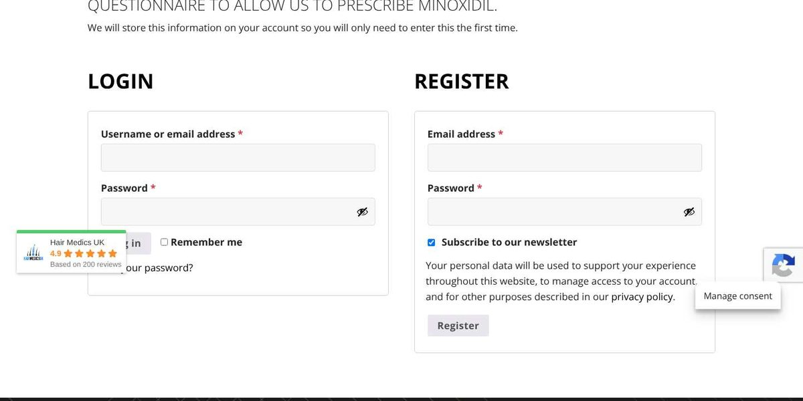

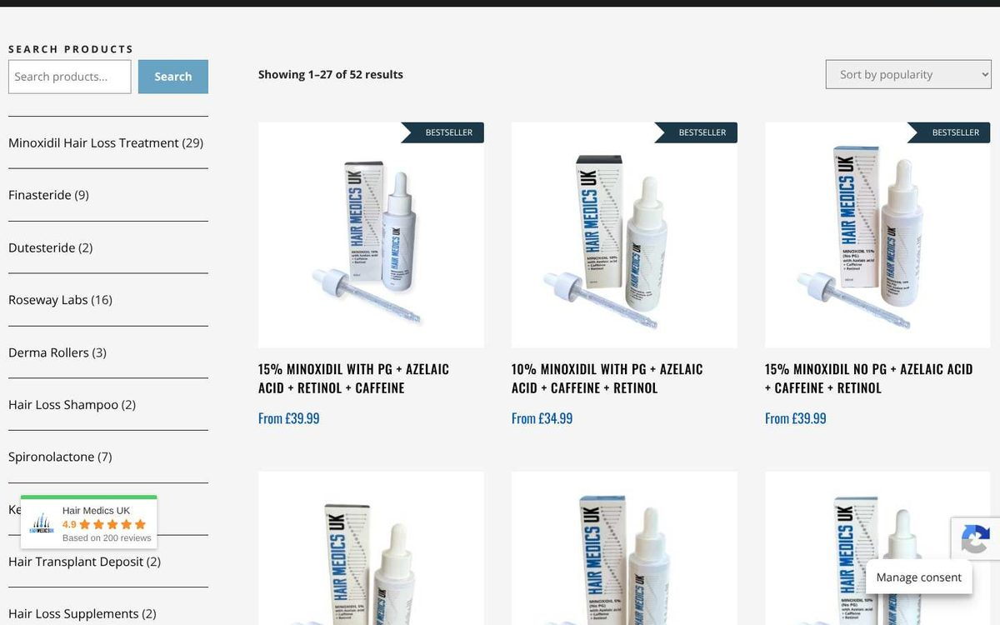

#### Cookie consent modal (M9)

The modal appeared on **252 of 255** first loads. The exception is `/cookie-policy-uk/`, where Complianz hides it by design.

**Why it matters:** it's the first thing every new visitor sees. It is good that "Deny" is offered on the first layer. However:

- **On mobile** it covers about 40% of the first screen.
- **On tablet** it runs edge to edge with no margins.
- "Accept" is a solid blue button while "Deny" and "View preferences" are pale grey. The ICO expects rejecting to be as easy as accepting, and visual nudging is one of the things it looks at.

**Fix:**

- On phones, use a bottom banner (about 30% of screen height).
- Style "Accept" and "Deny" identically.
- Keep "View preferences" as a text link.

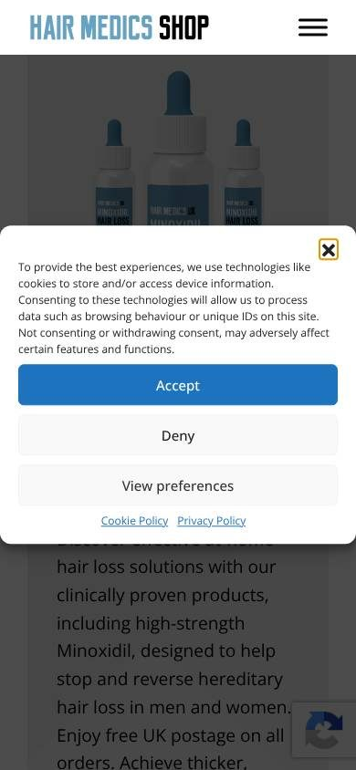

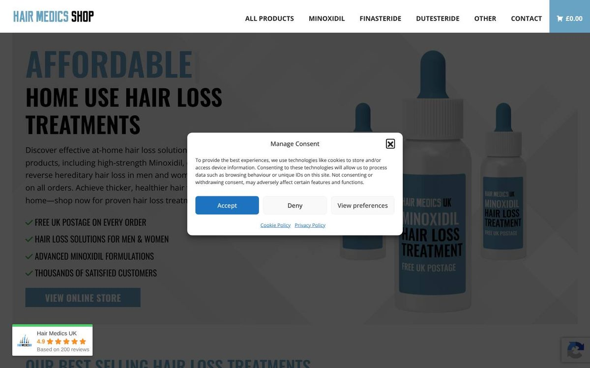

#### Visual consistency (L4)

The site mixes several unrelated styles:

- **Headings:** condensed Oswald capitals for page and product titles; thin, light uppercase Open Sans for product-description headings ("DESCRIPTION", "MAIN INGREDIENTS"); gold, widely letter-spaced "RELATED PRODUCTS".
- **Other text:** heavy Open Sans in the empty basket, a handwriting font (Caveat) for one testimonial, and Arial in the reviews widget.
- **Buttons:** five styles — blue filled (Add to basket), black outline (Contact "Submit", assessment "Next"), WooCommerce grey (Log in / Register), dark pills (basket) and white outline on black ("CONTACT US").

**Why it matters:** inconsistency makes a medical shop look less trustworthy. It also makes the new build harder, because there is no single design system to copy.

**Fix:** define one heading style, one body style and two button styles (primary and secondary), then apply them everywhere.

### 4.2 Mobile (390 px)

- **The first screen** is mostly the hero image plus the cookie modal. The H1 starts about 380 px down.
- **Horizontal overflow on 5 product pages (H6).** The browser widened the page to 395–415 px because unbroken words in product names don't fit a narrow column:
  - "SOLUTIONSPIRONOLACTONE" (the garbled product name)
  - "MEDROXYPROGESTERONE" (in a related-product card)

  The pages are `/product/finasteride-0-1-topical-hair-loss-solution/`, `/product/finasteride-1-mg-tablets/`, `/product/minocream-minoxidil-hair-cream/` and two Roseway Labs tonics. Visitors will see the page wobble sideways. In the left screenshot below, the cookie modal is even cut off on the left. Related products are random, so other pages can be affected on other visits.
  - **Fix:** rename product 17350, and add `overflow-wrap: anywhere; hyphens: auto;` to `.product_title` and `.woocommerce-loop-product__title`.

  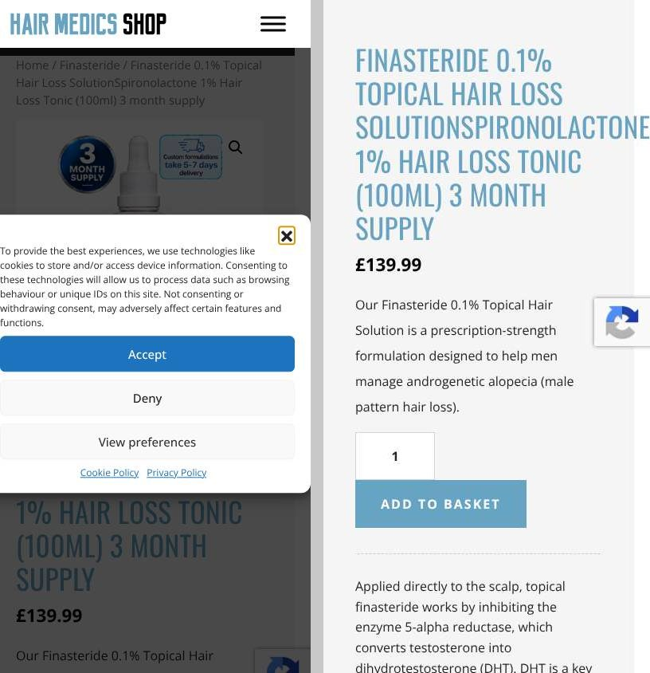

- **The product grid is hard to scan (M5).** Two columns about 150 px wide, with long ALL-CAPS names, mean names wrap to 6–10 lines. For example, "ADJUSTABLE MICRONEEDLING DERMA STAMP – 140 TITANIUM PINS PROFESSIONAL MICRONEEDLE DERMAPEN FOR HAIR AND BEARD GROWTH" takes 10 lines, while the product image is small. Capitals are slower to read because every word is the same rectangular shape.

  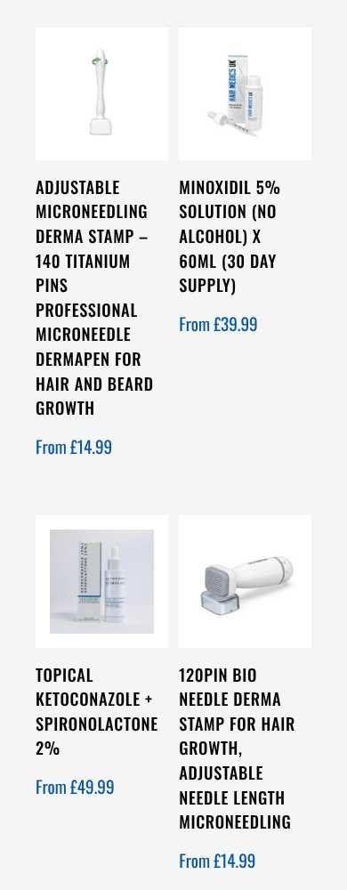

- **Variation dropdowns are cut off to "Choos" (M6).** The label box ("Pack Size", "Strength", "Amount of bottles", "Model") takes 60% of the row, leaving the select too narrow for "Choose an option". The Add to basket button below is pale and disabled, with no message explaining why. The Minocream screenshot also shows the description talking about "**Minobeard**" (M3).

  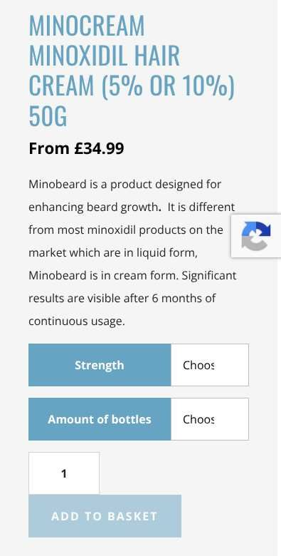

- **Category pages put 2–3 paragraphs of intro text before the products (M8).** On `/product-category/dutesteride/` the first product appears about 900 px down, below the first screen. The heading also shows the misspelling "DUTESTERIDE".

  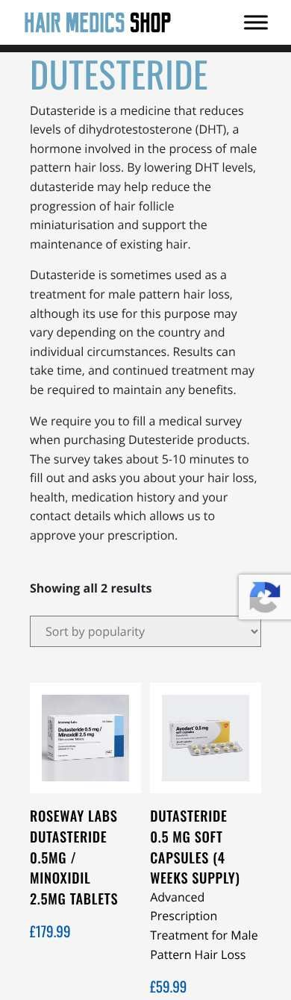

- **There is no search and no category filter (H11).** The desktop sidebar ("Search products" plus the category list) is removed on mobile, and the header has no search icon.
- **The footer link list is cramped.** Links are about 20 px tall, two per line, with little spacing. That accounts for most of the 20–36 small tap targets per page (M12).
- **Policy pages:** H1s such as "UNLICENSED MEDICINES & PRESCRIBING POLICY" wrap to 4 lines in very large type before any content (L9). `/privacy-policy/` is 22,600 px tall on mobile, about 27 screens. It has a table of contents but no "back to top".

### 4.3 Tablet (768 px)

- **Tablet uses the phone layout stretched to 768 px:** a hamburger menu, single-column pages and the sidebar removed.
- **Product pages (M7):** the gallery image is about 690 px tall. The product title starts about 830 px down, so the price and Add to basket button are not on the first screen. A tablet is wide enough for a two-column (image | details) layout.

  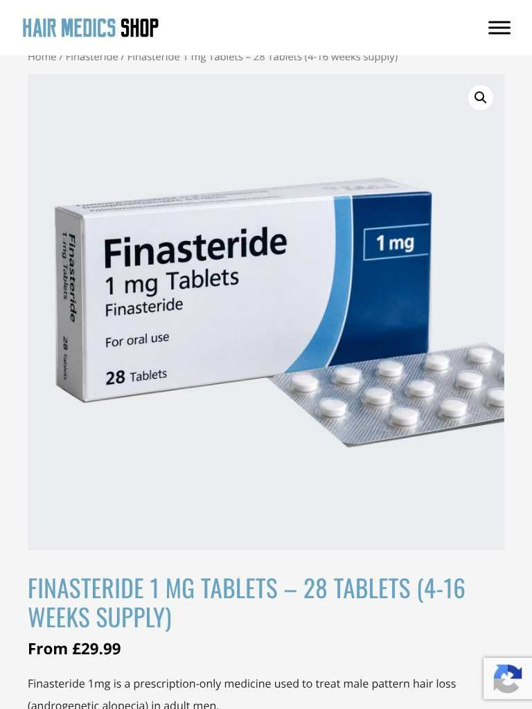

- **Shop and categories:** a two-column grid with large gaps, and no search or category filter.
- **Home:** the testimonial photo is shown very large, stacked above the quote. The cookie modal runs edge to edge.

### 4.4 Desktop (1440 px)

- **The layout is generally tidy.** The header menu is clear, product grids use three columns and product names fit on two lines.
- **The "OTHER" menu item** hides six categories (Derma Rollers, Spironolactone, Supplements, Hair Loss Shampoo, Minoxidil-free Products, Laser Diode). "Other" gives visitors no clue what is inside (H11).
- **The floating widgets** overlap content (see 4.1).
- **Empty or unfinished areas:**
  - `/search/` and `/search-2/` show only a heading — no search box at all.
  - The About page ends with "VIEW OUR WORLD CLASS SURGEONS BELOW:" followed by nothing.
  - The About page's contact band has no left padding, so its text touches the window edge. That band is also where the second phone number appears.

  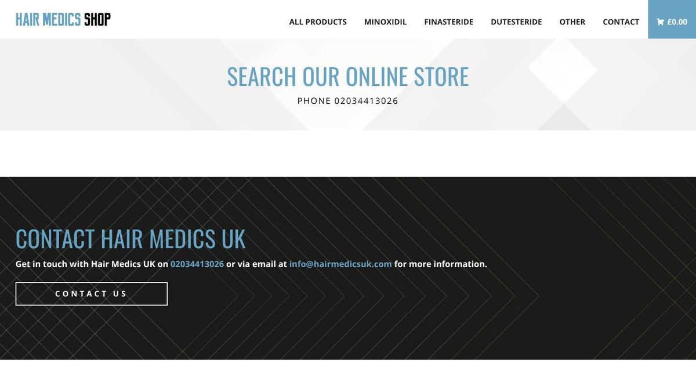

  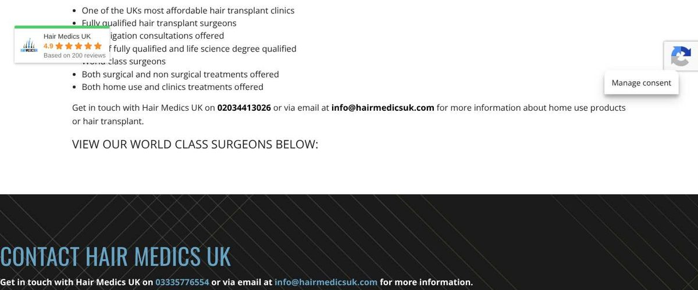

---

## 5. UX and conversion

| Area | What we found | Why it matters | Fix |
|---|---|---|---|
| Finding products (H11) | No header search at any size; the sidebar filter disappears below desktop width; empty search pages; vague "OTHER" menu | Visitors who know what they want ("finasteride 1 mg") can't type it on a phone, and most shop traffic is mobile | Header search icon that opens a full-width field; a "Filter by category" control on mobile; rename "OTHER" to something meaningful or list the categories |
| Dead ends (H5) | Empty basket "New in store" leads with two £0 products showing "Read more" and no price | The moment someone has nothing in the basket is your chance to win them back. Showing broken products there does the opposite | Hide unpurchasable products. Show bestsellers with prices |
| Prescription journey (H12, C1) | Product pages say "Prescription required" but go straight to Add to basket. The assessment is a separate page that asks visitors to *type* product names. My Account says it is needed "to prescribe minoxidil" only | Customers don't know what happens next and may drop out at checkout. Clinically, the prescriber must see exactly what is being ordered | Add a short "How it works" strip (1 Choose treatment → 2 Online consultation → 3 Prescriber review → 4 Dispatch). Make the consultation part of checkout, pre-filled from the basket |
| Choosing options (M6, M3) | "Choos" dropdowns; disabled button with no message; pack sizes named differently on every product | Fiddly option pickers are one of the most common reasons people abandon a product page | Full-width selects or buttons (for example "1 bottle · 3 bottles"), and a consistent "Pack size" label |
| Trust (H10, M16, M17) | Badges covering buttons; transplant reviews on a pharmacy shop; mixed brand names | People buying medicines online look for signals that the seller is legitimate | Cleaner layout, relevant reviews, and one clear identity in the footer |
| Forms (H2, L5) | Pre-ticked newsletter; the contact form requires phone, postcode and treatment type | Every required field lowers completion rates. Pre-ticked consent also creates legal risk (section 9) | Ask only for name, email and message; make marketing opt-in |
| Price display | "From £34.99" on variable products is fine. The laser products show a permanent-looking strike-through sale (H9) | Reference prices must be genuine, and customers distrust a permanent sale | Use "was" prices only for real, time-limited reductions |

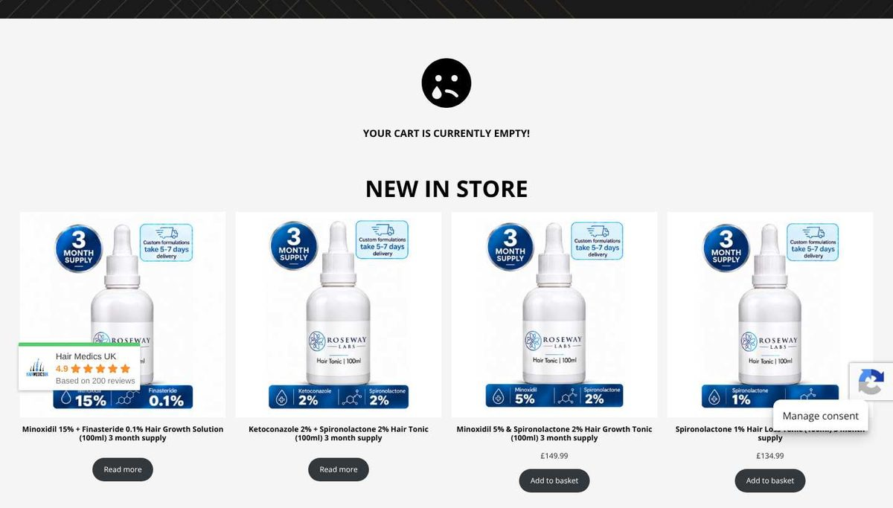

---

## 6. Accessibility

These are spot checks, not a full WCAG audit. A screen-reader and keyboard pass is still recommended.

- **Missing alt text on the most important image (M10).** On 48 of 52 product pages the main product photo has `alt=""`, which tells screen readers to skip it. The 4 promo images on the home page also have empty alt. The 11 empty alts on `/google-reviews/` are reviewer avatars, and empty alt is correct for those. In total, 63 images have empty alt on desktop.
  - *Why it matters:* a blind customer gets no confirmation of what the product or pack looks like.
  - *Fix:* in Media Library, set each product image's "Alternative text" to the product name and strength.
- **Colour contrast (M11).** The light-blue headings (around `#6E9EC0` measured from screenshots) on the light-grey background (`#F5F5F5`) come out at about 2.6–2.9:1. WCAG needs 3:1 for large text and 4.5:1 for normal text.
  - *Why it matters:* the H1s on every product page are hard to read for people with low vision, and outdoors on a phone.
  - *Fix:* check the real CSS values in a contrast checker and darken the text blue. Keep the light blue for backgrounds and borders only.
  - The disabled Add to basket button is about 1.7:1. WCAG exempts disabled controls, but users still can't tell it is a button (M6).
- **Tap targets (M12).** Mobile pages average 23 links or buttons under 32 px (tablet: 24). The worst is `/google-reviews/` with 36. Most are footer links, social icons and breadcrumb links.
  - *Fix:* aim for 44 × 44 px (Apple's guideline). WCAG 2.2's minimum is 24 × 24 px with spacing.
- **Focus hidden by floating widgets (H10).** A badge covering the Log in button fails WCAG 2.2 criterion 2.4.11 (Focus Not Obscured).
- **Readability.** There are long ALL-CAPS product names, letter-spaced ALL-CAPS page subtitles ("TO ASK ANY QUESTIONS OR TO REQUEST A CONSULTATION, …") and a handwriting font for a testimonial. None of these is a WCAG failure, but all are harder to read, especially for people with dyslexia.
- **H1 problems.**
  - `/shop/` has an empty H1, so screen-reader users get no page heading.
  - `/legal-compliance/` has 11 H1s, which flattens the outline.
  - The home H1 includes a literal "|" (L6).
- **What passed:**
  - `lang="en-GB"` is set on every page.
  - There is a "Skip to content" link.
  - No text is smaller than 12 px.
  - Contact, login and registration fields have labels.
  - No images are broken.

---

## 7. SEO and metadata

| Check | Result | Why it matters | Fix |
|---|---|---|---|
| Meta descriptions (M13) | **75 of 85 pages have none**, including **51 of 52 products**. Only the home page, shop, About, 6 categories and the laser cap have one | Google writes its own snippet, often from footer or warning text, so your listings look worse in search results | In Yoast, write a 140–155 character description per product: strength, form, supply length and "UK prescriber" |
| Title length | 61 of 85 titles are over 60 characters. The " • Hair Medics UK Online Store" suffix alone is about 30 characters | Titles get cut off in search results | Shorten the suffix to "Hair Medics" and remove marketing text from product names |
| H1 | `/shop/` H1 is **empty**; `/legal-compliance/` has **11**; `/checkout/` shows "BASKET" (normal for an empty basket) | The H1 tells search engines and screen readers what the page is | Set the shop page title. Turn the policy sub-headings into H2s |
| Spelling in URLs (M2) | `/product-category/dutesteride/`; 8 product URLs use "minoxdil" (for example `/product/5-minoxdil/`, `/product/10-minoxdil-no-pg/`); `/product/topical-ketoconazole-spirolcatone-2/` | People search for the correct spelling ("dutasteride", "minoxidil"). Misspellings also look careless | Fix the slugs and **add 301 redirects** from the old URLs (Yoast Premium or the Redirection plugin) |
| Name/URL mismatch | `40-titanium-pins…` for a 140-pin stamp; `…-x-100ml` for four products now sold as 60 ml | Confusing for users and search engines | Fix together with M2 |
| Duplicates and thin pages (M14) | `/cookie-policy/` and `/cookie-policy-uk/`; empty `/search/` and `/search-2/` | Thin or duplicate pages dilute the site and confuse visitors | Keep one cookie policy and 301 the other. Delete the search pages |
| Sitemap | The page sitemap lists `/basket/`, `/checkout/`, `/my-account/`, `/search/` and `/search-2/` | Utility pages shouldn't be indexed | Set them to noindex in Yoast, which also removes them from the sitemap |
| Orphan pages | About, Google reviews, CQC policy, Home-use disclaimer and the old cookie policy are not linked from the header or footer | Pages with no internal links are hard for both people and Google to find. Decide whether each one should exist (C5 says the disclaimer should not) | Link the useful pages from the footer; remove the rest |
| Structured data (L2) | Yoast/WooCommerce Product schema is on 49 of 52 products. The 3 £0 products have none. The Organization `logo.url` is empty | Rich results (price, availability) need valid Product data. The logo helps the brand panel | Set the logo under Yoast → Settings → Site representation |
| Brand names | The WebSite schema says "Hair Medics Shop", the Organization says "Hair Medics UK" and titles say "Hair Medics UK Online Store" | Inconsistent entity names weaken brand signals | Pick one (see M17) |
| Internal links (L8) | Some links (footer Privacy/Cookie links, the "Contact us" band, the home "View online store" button) omit the trailing slash, so each click causes an extra redirect | Small crawl-efficiency and speed cost | Use the exact canonical URLs |
| Crawlability (M19) | The firewall returns 403 to headless browsers and 429 to bursts | Can block Google's renderer, SEO tools and link previews (WhatsApp, Slack and others) | See section 10 |

---

## 8. Content and data quality

### Catalogue data (from the WooCommerce Store API)

| Issue | Detail | Why it matters | Fix |
|---|---|---|---|
| £0 products (H5) | IDs **17361** (Minoxidil 15% + Finasteride 0.1%), **17358** (Ketoconazole 2% + Spironolactone 2%) and **17346** (Minoxidil 5% + Finasteride 0.1%) have price £0 and `is_purchasable: false`, but they still appear in category grids (Finasteride, Minoxidil, Ketoconazole, Spironolactone, Roseway Labs) with no price | Customers see products they can't buy; it looks broken | Add prices or set them to Draft |
| Garbled name (H6) | ID **17350**: "Finasteride 0.1% Topical Hair Loss SolutionSpironolactone 1% Hair Loss Tonic (100ml) 3 month supply". The URL says finasteride; the name mentions both | For a medicine, the name must say exactly what it is. Patients could order the wrong product | Rename it to the correct single product and check the description matches |
| Deposit labels (H7) | "Deposit amount" options **1350 / 1999 / 2499 / 3999** charge **£1,249.50 / £1,499.50 / £1,999.50 / £2,499.50** | A customer choosing "1999" and being charged £1,499.50 will query it or raise a chargeback | Label each option with the amount charged, or explain the difference |
| Phantom models (H8) | The laser cap lists **LTD200s, LTD160Pro, LTD88lite**, but only an **LTD200s** variation exists (£499) | Customers choosing the other models hit an "unavailable" message | Remove the unused attribute terms |
| Pack size on a simple product (M3) | **Finasteride 5 mg** (ID 17067) is a *simple* product at £39.99 but carries a "Pack size" attribute with 4, 8, 12 and 16 weeks | Implies choices that don't exist | Either make it variable with real prices, or remove the attribute |
| Contradictory name (M3) | **Finasteride 1 mg Tablets – 28 Tablets (4–16 weeks supply)**: pack options run from 4 weeks (£29.99) to 16 weeks (£99.99), but the name says 28 tablets | Confusing quantity information for a medicine | Name it "Finasteride 1 mg tablets" and let the option state the quantity |
| Wrong product description (M3) | Minocream's short description: "Minobeard is a product designed for enhancing beard growth… Minobeard is in cream form" | Customers will wonder whether they are buying the right product | Rewrite it |
| Attribute naming (M3) | The same idea has 9 names: "Pack Size", "PACK SIZE", "Pack size", "No. of bottles", "No. of Bottles", "Bottles", "Amount of bottles", "Bottle Amount", "Quantity" (also "1 bottle" vs "1 Bottle") | Inconsistent filters and labels; harder to maintain and migrate | Create one global attribute, "Pack size", and reuse it |
| Name vs pack size | Four "x 60ml" products have "-x-100ml" URLs | Mixed messages about quantity | Fix the slugs with redirects (M2) |
| Urgency in a name (H9) | "I-Helmet Laser Hair Growth Comb – 40% off Sales! Limited stock available – First come first serve basis." | The claim shows up everywhere the name does (titles, emails, invoices, Google) and can't expire | Move offers into the sale price and badge, and remove them from the name |

### Copy and spelling

- **Errors in medical copy (M4).** These are taken from the pages as published:
  - The 10% minoxidil page says "Results after 48 weeks (~1 year) showed 5% minoxidil offered much better results than 2%, and 2% minoxidil offered better results than 2%". The last "2%" should presumably be "placebo".
  - Also on that page: "10% minoxdil is a topically applied product", "people were either give 5% minoxidil", "These trials clearly shows", "You hair loss is sudden", "You have blood pressure problem", and "Your scalp is red, inflamed… you use other medicines on the scalp" (two warnings merged into one).
  - The laser cap lists "**Post Mortem** Hair Loss" (presumably *postpartum*) and "Wear hair" (presumably *weak hair*).
  - *Why it matters:* on a site selling medicines, errors in efficacy and safety text undermine trust and can mislead.
  - *Fix:* ask your pharmacist to review all product descriptions, then proofread them.
- **About page (M15).** Typos: "advancement's", "Exicision" (Excision), "very easy to get too" (to), "Men and Woman" (Women). The page is about hair-transplant surgery ("Our Doctors combined have performed 1000's of hair transplant procedures", "World class surgeons"), not the online shop, and ends with an empty "surgeons" section. The home page also says "Hair Medics UK was voted Prestige Award's hair transplant clinic of the year 2024/2025".
- **Repeated text.** On several products the short description is repeated word for word as the first paragraph of the long description.
- **Brand and identity (M17).**
  - Logo: "HAIR MEDICS SHOP".
  - Page titles: "Hair Medics UK Online Store".
  - Privacy policy: "HAIR MEDICAL UK LIMITED (doing business as Hair Medics UK)".
  - Disclaimer: "Hair Medical U.K."
  - Domains: hairmedicsuk.shop, email @hairmedicsuk.com, and the privacy policy refers to hairmedics.co.uk.
  - Footer credit: "Website Design by Kall Kwik Bury St Edmunds".
  - The CQC policy page explains that a sister company, Skin Medics UK, is the CQC-registered provider.
  - *Fix:* one trading name in the logo and titles, plus a single footer line: "Hair Medics Shop is a trading name of [legal entity], company no. …, registered office …".

---

## 9. Compliance and trust

> **Reminder:** these are observations to take to your **superintendent pharmacist and legal adviser**. They are not legal advice, and the references are pointers for that conversation.

### C1 — Prescription-only medicines promoted to the public (Critical)

**Found:**

- The home page "Our best selling hair loss treatments" carousel shows **"BESTSELLER"** badges and prices on high-strength minoxidil solutions.
- Finasteride and Dutasteride are **top-level menu items**.
- POM product pages (for example Finasteride 1 mg) show price and pack size with an **Add to basket** button.
- Many products are compounded "specials" (Roseway Labs / JLE), made as unlicensed medicines.

**Why it matters:**

- The **Human Medicines Regulations 2012** (regulation 284) prohibit advertising prescription-only medicines to the public.
- The MHRA's guidance on unlicensed "specials" (Guidance Note 14) says they must not be advertised at all.
- **GPhC guidance** for pharmacies selling at a distance says people should not be able to choose a POM and its quantity before an appropriate consultation.
- Regulators actively enforce this against online pharmacies. ASA rulings on prescription weight-loss medicines are a recent example.

**Recommendation:** review with your superintendent pharmacist and adviser. The usual pattern is:

- condition-led pages ("Treatments for male pattern hair loss") with neutral information
- a consultation first
- the prescriber decides the medicine and quantity
- no "Bestseller" badges, discounts or promotional claims on POMs

### C2 — Medicinal claims (Critical)

**Found:**

- Home: "**Cure hair loss at home** with our advanced Minoxidil hair loss treatments, **clinically proven** to help stop and reverse hereditary hair loss", and "our clinically proven products".
- 10% minoxidil: "…makes this solution **much more effective** than minoxidil alone".
- Minocream: "You will be amazed by how much Minocream can transform your appearance".

**Why it matters:** "Cure" is an absolute claim that hair-loss treatments can't support. "Clinically proven" needs evidence for *that* product; compounded combinations generally have none. The CAP Code (section 12) requires documentary evidence for health claims and restricts how medicines are advertised.

**Recommendation:** remove "cure". Only say "clinically proven" where you hold evidence for the exact product, or describe the evidence for the ingredient accurately ("minoxidil is licensed in the UK for…").

### C3 — Conflicting pharmacy registration details (Critical)

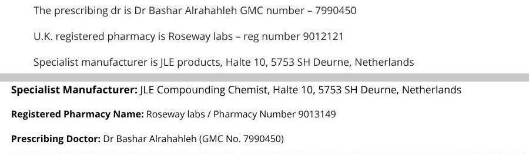

**Found:**

- The footer on every page says "Registered Pharmacy Name: Roseway labs / **Pharmacy Number 9013149**".
- `/medical-assessment/` says "U.K. registered pharmacy is Roseway labs – **reg number 9012121**".
- The manufacturer appears as "JLE Compounding Chemist" in the footer and "JLE products" on the assessment page.

**Why it matters:** patients and regulators use the GPhC number to check that an online pharmacy is genuine. Two numbers means at least one is wrong, which looks like a red flag.

**Recommendation:**

- Check the GPhC register, correct both places and link the number to the register entry.
- Review with your superintendent pharmacist whether the site shows what GPhC distance-selling guidance expects: who owns and runs the pharmacy, the superintendent pharmacist, the registered pharmacy address and how to check its registration.
- Also confirm how the prescriber relationship and the overseas manufacturer (M18) should be described.

### C4 — Draft legal page live; business identity missing (Critical)

**Found:**

- `/legal-compliance/` contains drafting instructions rather than content, for example: "The legal name of the business operating the shop, registered office, company number, trading address, email address and other legally required contact details should be displayed on the website and **inserted into this policy before publication**."
- It ends with "9. PUBLICATION AND COMPLIANCE CHECKLIST — Insert the exact legal entity name, company number, registered office…".
- It is linked from the footer of every page.
- No page on the site states the company number or registered office. The T&Cs say these "shall be displayed on the Website".

**Why it matters:**

- UK e-commerce and company-disclosure rules (Electronic Commerce Regulations 2002; Companies Act / Company, LLP and Business Names Regulations 2015) require a business website to show its legal name, geographic address, email, and its company number and registered office if it is a company.
- A visible draft tells visitors the policies aren't real.

**Recommendation:**

- Set the page to Draft today.
- Publish properly reviewed T&Cs, delivery and complaints policies.
- Add the legal entity line to the footer (see M17).

### C5 — Disclaimer contradicts selling medicines (Critical)

**Found:** `/home-use-products-disclaimer/` says:

- "No products purchased from www.hairmedicsuk.com shall be considered to be foods, drugs or medical devices. Under NO circumstances shall/should ANY of these materials be used for therapeutic or diagnostic purposes."
- The purchaser must "indemnify and hold www.hairmedicsuk.com … harmless from all claims".
- "Hair Medical U.K." is not liable for damages.

**Why it matters:** this contradicts the whole basis of the shop, which sells prescribed medicines for a therapeutic purpose. It also names a different business name and domain. Under the Consumer Rights Act 2015, a business can't exclude liability for death or personal injury caused by negligence, so terms like this are likely unenforceable and could be judged unfair.

**Recommendation:** unpublish the page and replace it with lawful, accurate wording from your adviser.

### H1 — 7-day returns (High)

**Found:**

- `/return-policy/`: "You have **7 days** from the date of delivery to return your item(s)… contact us within 7 days of receiving your order: **0333 577 6554**."
- `/legal-compliance/` says customers may cancel "within the applicable statutory period", so the two pages contradict each other.

**Why it matters:** the Consumer Contracts (Information, Cancellation and Additional Charges) Regulations 2013 generally give consumers **14 days** to cancel a distance sale. There are exceptions, for example sealed health or hygiene goods once unsealed, and goods made to the consumer's specification, such as compounded prescriptions. If the required cancellation information isn't given, the cancellation period can be extended by up to 12 months.

**Recommendation:** legal review. State the 14-day right, list exactly which items are exempt and why, and use one phone number (M1).

### H2 — Pre-selected marketing consent (High)

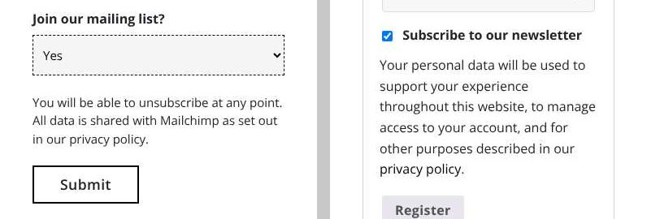

**Why it matters:** under UK GDPR and PECR, consent to marketing must be a clear, active choice. Pre-ticked boxes and "Yes" defaults are not valid consent, so the resulting mailing list may not be usable. That risks complaints and ICO action.

**Recommendation:**

- Untick the checkbox and default the dropdown to "No" (or blank).
- Record when and how each subscriber opted in.
- Review the existing Mailchimp list with your adviser.

### H3 — Analytics without consent signal (High, verify)

**Found:** on all 255 page loads, the browser sent a Google Analytics 4 hit (`google-analytics.com/g/collect?…tid=G-NCDG9H84FB…&gcd=13l3l3l3l1l1`). In every case the visitor either did nothing or clicked **Deny**, and never clicked Accept. In the `gcd` parameter, the "l" values mean that no consent state (granted or denied) was set at all.

**Why it matters:** PECR requires consent before non-essential cookies or similar tracking. The site's own `/legal-compliance/` says "Non-essential cookies should not be placed before valid consent".

**Recommendation:** to verify, open a private window, load the home page without clicking anything, then open DevTools:

- Network tab, filter `collect`
- Application → Cookies, look for `_ga`

If either is present, either:

- let Complianz block the GA tag until consent, or
- enable Google Consent Mode v2 in Complianz so GA receives a "denied" default.

### H4 — Privacy policy (High)

**Found:**

- "Last updated June 03, 2024".
- It describes "our website at https://hairmedics.co.uk" and links to a cookie notice on that domain.
- It says data may be shared with sister company Skin Medics UK.

**Why it matters:**

- The shop collects **health data** (special category data) through the medical assessment. The privacy notice must explain the lawful basis, who receives it (prescriber, pharmacy, manufacturer, Mailchimp, Stripe) and how long it is kept.
- Pointing to another domain's notices means visitors aren't properly informed.

**Recommendation:** commission a privacy notice written for this shop and its data flows.

### H8 / H9 — Device and pricing claims (High)

- **"FDA approved".** Low-level laser hair devices are typically FDA *cleared* (510(k)), not "approved". In the UK the relevant marking is UKCA or CE, and the device should be registered with the MHRA. Listing conditions it "treats" (telogen effluvium, alopecia areata) is a medical claim that needs evidence.
- **Urgency and "was" prices.** Under the **Digital Markets, Competition and Consumers Act 2024** (which replaced the CPRs in April 2025), false urgency ("Limited stock… first come first serve") and misleading reference prices can be unfair commercial practices.

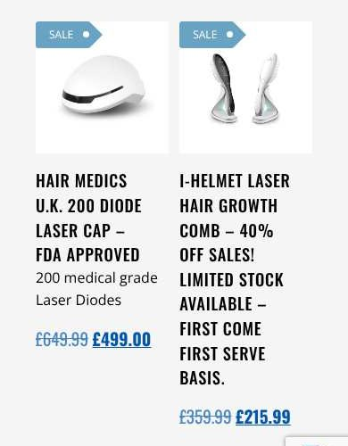

### M16 — Reviews (Medium)

**Found:**

- `/google-reviews/` (not linked from the menu) shows Google reviews that are almost all about **hair-transplant surgery with Dr Hamad Hawama**.
- Dates are relative ("4 days ago", "2 weeks ago").
- One reviewer name appears twice with different reviews.
- The floating "Hair Medics UK 4.9 · Based on 200 reviews" badge on every desktop page implies the reviews are for the products in the shop.

**Why it matters:** reviews must not mislead about what they relate to. The DMCC Act 2024 also bans fake or misleading consumer reviews and expects businesses to take reasonable steps to prevent them.

**Recommendation:** collect product or pharmacy-service reviews (for example via a verified-buyer tool), or label clearly that these are reviews of the clinic.

### M18 — Supply-chain description (Medium)

**Found:** the footer names "Specialist Manufacturer: JLE Compounding Chemist, Halte 10, 5753 SH Deurne, Netherlands"; the assessment page says "JLE products".

**Why it matters:** importing and supplying unlicensed medicines into the UK has its own licensing and notification requirements. How this is described on the site should match what actually happens.

**Recommendation:** confirm the wording, and the underlying arrangements, with your superintendent pharmacist.

---

## 10. Technical and hosting

| Area | Found | Why it matters | Fix |
|---|---|---|---|
| Availability | All 255 loads returned **200** | Good | — |
| Firewall (M19) | The host's firewall (20i StackProtect) returned **403** to headless browsers and **429** on bursts. We needed retries with back-off to crawl the site | The same protection can block Google's rendering, uptime monitors, SEO crawlers and link previews, so pages may be missing from search or share without previews | In the 20i panel, whitelist known good bots (Google, Bing), your uptime monitor and SEO tools. Raise burst limits for normal page assets |
| HTTP 401 (M20) | "Failed to load resource: 401 (Unauthorized)": 226 errors in 170 of 255 loads, on **every one of the 85 URLs** | Something on every page calls an endpoint it isn't allowed to. It is often a plugin's REST/AJAX call, a licence check or a widget, and that feature is probably broken | Open DevTools → Network, filter "401", find the request URL and its initiator, then fix the credentials or remove the plugin |
| Other HTTP errors | **403** twice on `/basket/` (desktop), probably the firewall; **405** (Method Not Allowed) on `/google-reviews/` at all sizes | A 405 usually means a form or "load more" request uses the wrong method, so "More reviews" may not work | Test "More reviews" and check the widget settings |
| Console noise (L1) | "requestStorageAccess: Permission denied", 334 times (every load) | From an embedded third-party iframe asking for cookie access. Harmless unless that widget needs to stay logged in | Identify which embed it is. No action needed if nothing breaks |
| Content Security Policy | One "Report Only… frame-ancestors" message and Google CSP report pings blocked (ORB) | Informational; comes from Google's reCAPTCHA/Maps frames | None |
| Overflow (H6) | Long unbroken words in product titles widen the mobile page | Sideways scroll and a broken layout | `overflow-wrap: anywhere` on product titles; fix the names |
| Images (L7) | Product galleries load the original files (1500–2560 px wide) | Large downloads on mobile data | Check in PageSpeed. Let WooCommerce serve the 600–800 px size. Compress images (WebP) |
| Fonts and scripts (L7) | Google Fonts: Open Sans, Oswald and **Caveat** (used for one testimonial). reCAPTCHA v3 loads on every page | Extra requests and render-blocking | Self-host fonts, drop Caveat, load reCAPTCHA only on form pages |
| Performance | **Not measured** (see Limitations) | — | Run PageSpeed Insights for home, shop, a category and a product, on mobile and desktop. Watch LCP (the hero or product image) and CLS (the badges) |
| Language | `lang="en-GB"` on every page | Good for screen readers and SEO | — |

---

## 11. What is working well

- The site is **reliable**: every URL loads, there are no broken images and pages fit the screen at all three sizes except the five overflow pages.
- The **regulatory footer** (prescriber with GMC number, pharmacy, manufacturer, address) is a good idea. It just needs to be accurate and consistent (C3).
- The **cookie modal offers Deny on the first layer**, and there is a persistent "Manage consent" control.
- **Product pages for newer items** (for example Finasteride 1 mg and 5 mg) have well-structured, careful safety information: "Prescription Required", side effects and "not for women or children".
- **Yoast/WooCommerce structured data** is present on almost every product, and XML sitemaps exist.
- The **phone number is a tap-to-call link**, and the email address is obfuscated against spam bots.
- **No text is smaller than 12 px** and **form fields are labelled**.

---

## 12. Suggested order of work

1. **This week (Critical):**
   - Unpublish `/legal-compliance/` and `/home-use-products-disclaimer/`.
   - Fix the pharmacy number (C3).
   - Remove "cure" and unproven claims (C2).
   - Book a review of the POM journey with your superintendent pharmacist (C1).
2. **Next 2–4 weeks (High):**
   - Returns policy (H1), consent defaults (H2), analytics consent (H3), privacy policy (H4).
   - Catalogue fixes (H5–H9).
   - Floating widgets (H10), mobile search (H11), consultation-to-checkout link (H12).
3. **Next sprint (Medium):**
   - Meta descriptions and URL fixes with redirects (M2, M13, M14).
   - Mobile and tablet layout fixes (M5–M8).
   - Accessibility fixes (M10–M12).
   - Phone number and brand identity clean-up (M1, M17).
4. **Backlog (Low):** L1–L9.

**If you are building a new site,** build these in from the start rather than porting the old problems:

- a single design system (fonts, one primary and one secondary button)
- `overflow-wrap` on titles
- sentence-case product names
- a header search on every breakpoint
- floating widgets that never cover content
- one global "Pack size" attribute
- correct slugs, with a redirect map from every old URL
- meta descriptions as a required field
- a consultation-first prescription flow agreed with your superintendent pharmacist

---

## Appendix A — per-URL results

Columns:

- **H1** is the first H1 on desktop, shortened where needed.
- **Meta description**: Y means present, N means missing.
- **Mobile targets < 32 px** is the number of links, buttons or fields smaller than 32 px in either direction on the 390 px mobile view.
- **Empty-alt images** is the number of `` elements with `alt=""` on desktop.

`/checkout/` shows "BASKET" because WooCommerce shows the basket when it is empty.

| # | URL | Type | H1 (desktop) | Meta description | Mobile targets < 32 px | Empty-alt images |
|---|---|---|---|---|---|---|
| 1 | `/` | Page | AFFORDABLE\| HOME USE HAIR LOSS TREATMENTS | Y | 22 | 4 |
| 2 | `/about-hair-medics-uk/` | Page | ABOUT HAIR MEDICS UK | Y | 24 | 0 |
| 3 | `/basket/` | Page | BASKET | N | 20 | 0 |
| 4 | `/checkout/` | Page | BASKET | N | 20 | 0 |
| 5 | `/contact/` | Page | CONTACT HAIR MEDICS UK | N | 25 | 0 |
| 6 | `/cookie-policy-uk/` | Page | COOKIE POLICY (UK) | N | 23 | 0 |
| 7 | `/cookie-policy/` | Page | COOKIE POLICY | N | 24 | 0 |
| 8 | `/cqc-policy/` | Page | CQC POLICY | N | 24 | 0 |
| 9 | `/google-reviews/` | Page | GOOGLE REVIEWS | N | 36 | 11 |
| 10 | `/home-use-products-disclaimer/` | Page | HOME USE PRODUCTS DISCLAIMER | N | 23 | 0 |
| 11 | `/legal-compliance/` | Page | LEGAL COMPLIANCE *(+10 more H1s)* | N | 24 | 0 |
| 12 | `/medical-assessment/` | Page | MEDICAL ASSESSMENT FORM | N | 23 | 0 |
| 13 | `/my-account/` | Page | LOGIN / REGISTER | N | 29 | 0 |
| 14 | `/privacy-policy/` | Page | PRIVACY POLICY | N | 25 | 0 |
| 15 | `/return-policy/` | Page | RETURN POLICY | N | 25 | 0 |
| 16 | `/search-2/` | Page | SEARCH | N | 23 | 0 |
| 17 | `/search/` | Page | SEARCH OUR ONLINE STORE | N | 23 | 0 |
| 18 | `/shop/` | Page | *(empty)* | Y | 20 | 0 |
| 19 | `/terms-and-conditions-of-business/` | Page | TERMS AND CONDITIONS OF BUSINESS | N | 23 | 0 |
| 20 | `/unlicensed-medicines-prescribing-policy/` | Page | UNLICENSED MEDICINES & PRESCRIBING POLICY | N | 23 | 0 |
| 21 | `/product-category/dutesteride/` | Category | DUTESTERIDE | Y | 20 | 0 |
| 22 | `/product-category/finasteride/` | Category | FINASTERIDE | Y | 20 | 0 |
| 23 | `/product-category/hair-loss-shampoo/` | Category | HAIR LOSS SHAMPOO | N | 20 | 0 |
| 24 | `/product-category/hair-loss-supplements/` | Category | HAIR LOSS SUPPLEMENTS | N | 20 | 0 |
| 25 | `/product-category/hair-transplant-deposit/` | Category | HAIR TRANSPLANT DEPOSIT | N | 20 | 0 |
| 26 | `/product-category/ketoconazole/` | Category | KETOCONAZOLE | N | 20 | 0 |
| 27 | `/product-category/laser-diode/` | Category | LASER DIODE | N | 20 | 0 |
| 28 | `/product-category/microneedling/` | Category | DERMA ROLLERS | Y | 20 | 0 |
| 29 | `/product-category/minoxidil-free-products/` | Category | MINOXIDIL FREE PRODUCTS | N | 20 | 0 |
| 30 | `/product-category/minoxidil/` | Category | MINOXIDIL HAIR LOSS TREATMENT | Y | 20 | 0 |
| 31 | `/product-category/roseway-labs/` | Category | ROSEWAY LABS | Y | 20 | 0 |
| 32 | `/product-category/spironolactone/` | Category | SPIRONOLACTONE | Y | 20 | 0 |
| 33 | `/product-tag/best-seller/` | Tag | BEST SELLER | N | 20 | 0 |
| 34 | `/product/10-minoxdil-no-pg/` | Product | 10% MINOXIDIL NO PG + AZELAIC ACID + CAFFEINE + RETINOL | N | 23 | 1 |
| 35 | `/product/10-minoxdil/` | Product | 10% MINOXIDIL WITH PG + AZELAIC ACID + CAFFEINE + RETINOL | N | 24 | 1 |
| 36 | `/product/10-minoxidil-with-trichosol/` | Product | 10% MINOXIDIL WITH TRICHOSOL (60 ML) | N | 23 | 1 |
| 37 | `/product/12-minoxidil-trichosol/` | Product | 12% MINOXIDIL WITH TRICHOSOL™️ (60ML) | N | 23 | 1 |
| 38 | `/product/15-minoxdil-no-pg/` | Product | 15% MINOXIDIL NO PG + AZELAIC ACID + CAFFEINE + RETINOL | N | 25 | 1 |
| 39 | `/product/15-minoxdil/` | Product | 15% MINOXIDIL WITH PG + AZELAIC ACID + RETINOL + CAFFEINE | N | 24 | 1 |
| 40 | `/product/15-minoxidil-hair-tonic-with-tretinoin-azelaic-acid-100ml/` | Product | ROSEWAY LABS HAIR TONIC – 15% MINOXIDIL HAIR TONIC WITH… | N | 22 | 1 |
| 41 | `/product/40-titanium-pins-professional-microneedle-dermapen/` | Product | ADJUSTABLE MICRONEEDLING DERMA STAMP – 140 TITANIUM PINS… | N | 23 | 1 |
| 42 | `/product/5-minoxdil-no-pg/` | Product | 5% MINOXIDIL NO PG + AZELAIC ACID + CAFFEINE + RETINOL | N | 23 | 1 |
| 43 | `/product/5-minoxdil-quick-dry-spray/` | Product | 5% MINOXIDIL – FAST DRY SPRAY WITH AZELAIC ACID | N | 23 | 1 |
| 44 | `/product/5-minoxdil/` | Product | 5% MINOXIDIL PG + AZELAIC ACID + CAFFEINE + RETINOL | N | 23 | 1 |
| 45 | `/product/anti-hair-loss-capsules-hair-ceuticals/` | Product | ANTI HAIR LOSS CAPSULES HAIR-CEUTICALS | N | 23 | 1 |
| 46 | `/product/bio-needle-derma-stamp-microneedling/` | Product | 120PIN BIO NEEDLE DERMA STAMP FOR HAIR GROWTH, ADJUSTABL… | N | 23 | 1 |
| 47 | `/product/dutasteride-0-5-mg-soft-capsules-4-weeks-supply/` | Product | DUTASTERIDE 0.5 MG SOFT CAPSULES (4 WEEKS SUPPLY) | N | 23 | 1 |
| 48 | `/product/e50-exosomes-hair-treatment-therapy-home-use/` | Product | E50 EXOSOMES (STEM CELL ACTIVATED) HAIR TREATMENT THERAP… | N | 23 | 1 |
| 49 | `/product/finasteride-0-1-topical-hair-loss-solution/` | Product | FINASTERIDE 0.1% TOPICAL HAIR LOSS SOLUTIONSPIRONOLACTON… | N | 24 | 1 |
| 50 | `/product/finasteride-0-25-topical-hair-tonic/` | Product | FINASTERIDE 0.25% TOPICAL HAIR TONIC – 100ML \| 3 MONTH S… | N | 24 | 1 |
| 51 | `/product/finasteride-1-mg-tablets/` | Product | FINASTERIDE 1 MG TABLETS – 28 TABLETS (4-16 WEEKS SUPPLY) | N | 23 | 1 |
| 52 | `/product/finasteride-5-mg-tablets-28-tablets-4-weeks-supply/` | Product | FINASTERIDE 5 MG TABLETS – 28 TABLETS (4 WEEKS SUPPLY) | N | 23 | 1 |
| 53 | `/product/hair-loss-consultation/` | Product | HAIR LOSS CONSULTATION | N | 23 | 1 |
| 54 | `/product/hair-medics-uk-shampoo/` | Product | HAIR MEDICS UK SHAMPOO | N | 23 | 1 |
| 55 | `/product/hair-transplant-deposit/` | Product | HAIR TRANSPLANT DEPOSIT | N | 23 | 1 |
| 56 | `/product/i-helmet-laser-hair-growth-comb/` | Product | I-HELMET LASER HAIR GROWTH COMB – 40% OFF SALES! LIMITED… | N | 23 | 1 |
| 57 | `/product/ihelmet-laser-hair-growth-system-hair-regrowth-helmet-laser-cap/` | Product | HAIR MEDICS U.K. 200 DIODE LASER CAP – FDA APPROVED | Y | 23 | 0 |
| 58 | `/product/ketoconazole-2-spironolactone-2-hair-tonic-100ml/` | Product | KETOCONAZOLE 2% + SPIRONOLACTONE 2% HAIR TONIC (100ML) 3… | N | 25 | 1 |
| 59 | `/product/loniten-5mg-tablets-minoxidil-oral-hair-loss-treatment-60-tablets/` | Product | LONITEN 5MG TABLETS (MINOXIDIL) – ORAL HAIR LOSS TREATME… | N | 22 | 0 |
| 60 | `/product/loniten-minoxidil-2-5mg-tablets-60-tablets/` | Product | LONITEN® MINOXIDIL 2.5MG TABLETS – 60 TABLETS | N | 22 | 0 |
| 61 | `/product/minocream-minoxidil-hair-cream/` | Product | MINOCREAM MINOXIDIL HAIR CREAM (5% OR 10%) 50G | N | 22 | 1 |
| 62 | `/product/minoxdil-7-5-quick-dry-spray/` | Product | 7.5% MINOXIDIL – FAST DRY SPRAY WITH AZELAIC ACID | N | 23 | 1 |
| 63 | `/product/minoxidil-10-finasteride-0-1-hair-loss-treatment-100ml/` | Product | MINOXIDIL 10% + FINASTERIDE 0.1% HAIR LOSS TREATMENT – 1… | N | 23 | 1 |
| 64 | `/product/minoxidil-10-quick-dry-spray/` | Product | 10% MINOXIDIL – FAST DRY SPRAY WITH AZELAIC ACID | N | 23 | 1 |
| 65 | `/product/minoxidil-15-finasteride-0-1-hair-growth-solution-100ml/` | Product | MINOXIDIL 15% + FINASTERIDE 0.1% HAIR GROWTH SOLUTION (1… | N | 24 | 1 |
| 66 | `/product/minoxidil-5-finasteride-0-1-hair-growth-solution/` | Product | MINOXIDIL 5% + FINASTERIDE 0.1% HAIR GROWTH SOLUTION 100… | N | 23 | 1 |
| 67 | `/product/minoxidil-5-finasteride-0-1-tretinoin-0-01-hair-tonic-100ml/` | Product | ROSEWAY LABS HAIR TONIC – MINOXIDIL 5% + FINASTERIDE 0.1… | N | 23 | 1 |
| 68 | `/product/minoxidil-5-medroxyprogesterone-0-0125-hair-tonic-100ml/` | Product | ROSEWAY LABS HAIR TONIC – MINOXIDIL 5% + MEDROXYPROGESTE… | N | 22 | 1 |
| 69 | `/product/minoxidil-5-melatonin-0-1-solution-x-100ml/` | Product | MINOXIDIL 5%/ MELATONIN 0.1% SOLUTION X 60ML (30 DAY SUP… | N | 22 | 0 |
| 70 | `/product/minoxidil-5-solution-no-alcohol-x-100ml/` | Product | MINOXIDIL 5% SOLUTION (NO ALCOHOL) X 60ML (30 DAY SUPPLY) | N | 22 | 1 |
| 71 | `/product/minoxidil-5-spironolactone-2-hair-growth-tonic-100ml/` | Product | MINOXIDIL 5% & SPIRONOLACTONE 2% HAIR GROWTH TONIC (100M… | N | 23 | 1 |
| 72 | `/product/minoxidil-5-spironolactone-2-solution-x-100ml/` | Product | MINOXIDIL 5%/ SPIRONOLACTONE 2% SOLUTION X 60ML (60 DAY… | N | 22 | 1 |
| 73 | `/product/nizoral-anti-dandruff-treatment-2-ketoconazole-shampoo-60ml/` | Product | NIZORAL ANTI-DANDRUFF TREATMENT 2% KETOCONAZOLE SHAMPOO… | N | 24 | 1 |
| 74 | `/product/nizoral-ketoconazole-2-antifungal-cream-30g/` | Product | NIZORAL KETOCONAZOLE 2% ANTIFUNGAL CREAM 30G | N | 23 | 1 |
| 75 | `/product/roseway-labs-dutasteride-0-5mg-minoxidil-2-5mg-tablets/` | Product | ROSEWAY LABS DUTASTERIDE 0.5MG / MINOXIDIL 2.5MG TABLETS | N | 23 | 1 |
| 76 | `/product/roseway-labs-hair-tonic-advanced-triple-ingredient-formula-100ml/` | Product | ROSEWAY LABS HAIR TONIC – ADVANCED TRIPLE-INGREDIENT FOR… | N | 22 | 1 |
| 77 | `/product/roseway-labs-hair-tonic-minoxidil-5-finasteride-0-25-tretinoin-0-01-100ml/` | Product | ROSEWAY LABS HAIR TONIC – MINOXIDIL 5% • FINASTERIDE 0.2… | N | 24 | 1 |
| 78 | `/product/roseway-labs-hair-tonic-minoxidil-5-tretinoin-0-01-azelaic-acid-2-100ml/` | Product | ROSEWAY LABS HAIR TONIC – MINOXIDIL 5% + TRETINOIN 0.01%… | N | 23 | 1 |
| 79 | `/product/roseway-labs-hair-tonic-minoxidil-7-saw-palmetto-5-tretinoin-0-01-100ml/` | Product | ROSEWAY LABS HAIR TONIC – MINOXIDIL 7% + SAW PALMETTO 5%… | N | 22 | 1 |
| 80 | `/product/spironolactone-1-hair-loss-tonic/` | Product | SPIRONOLACTONE 1% HAIR LOSS TONIC (100ML) 3 MONTH SUPPLY | N | 24 | 1 |
| 81 | `/product/spironolactone-1-solution-x-100ml/` | Product | SPIRONOLACTONE 1% SOLUTION X 60ML(60 DAY SUPPLY) | N | 24 | 1 |
| 82 | `/product/spironolactone-for-female-pattern-hair-loss/` | Product | SPIRONOLACTONE FOR FEMALE PATTERN HAIR LOSS | N | 23 | 1 |
| 83 | `/product/titanium-derma-roller/` | Product | HAIR MEDICS UK TITANIUM DERMA ROLLER | N | 23 | 1 |
| 84 | `/product/topical-ketoconazole-spirolcatone-2/` | Product | TOPICAL KETOCONAZOLE + SPIRONOLACTONE 2% | N | 23 | 1 |
| 85 | `/product/tricho-gen-rapid-hair-growth-stimulation-60ml/` | Product | TRICHO-GEN+ RAPID HAIR GROWTH STIMULATION 60ML | N | 23 | 1 |
